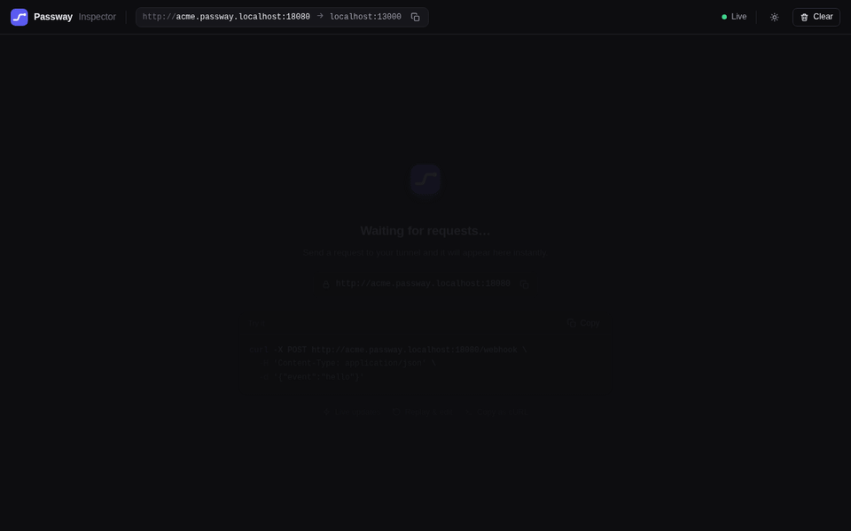

<!-- OWNER: replace <domain> with the Passway Cloud domain once it exists
     (also in docs/launch/). See docs/launch/checklist.md. -->

# Passway

**An open-source, self-hostable ngrok alternative built for webhook debugging.**

`passway http 3000` gives your local app a public HTTPS URL. A local inspector
shows every request that comes through it, and you can replay any of them
with one click.



## Quickstart (Passway Cloud)

Install the CLI:

```sh
curl -fsSL https://<domain>/install.sh | sh
# or
brew install mohammed19n/tap/passway
```

Prebuilt binaries for Linux, macOS and Windows are on the
[releases page](https://github.com/mohammed19n/passway/releases). The install
script verifies the archive's checksum before installing anything.

Then:

1. Sign in at `https://<domain>` with GitHub.
2. Create a CLI token under **CLI tokens**, then run `passway login <token>`.
3. Run `passway http 3000`.

```
Forwarding   https://<your-name>.<domain> -> http://localhost:3000
Plan         Free - 60 req/min - 1 GB/month
Inspector    http://127.0.0.1:4040
```

Point Stripe, GitHub, Shopify or any webhook sender at that URL, and open the
inspector.

## Features

- **A complete tunnel.** It streams request and response bodies, handles
  WebSockets and large uploads, and reconnects automatically while keeping the
  same URL. The client makes one outbound connection over HTTPS on port 443,
  so it works through most corporate firewalls.
- **The inspector** at http://127.0.0.1:4040 lists every request live, with
  headers, bodies (JSON pretty-printed) and timing for both the request and
  the response.
  - **Replay** resends a request unchanged, including headers such as
    `Stripe-Signature`.
  - **Edit & Replay** lets you change the method, path, headers or body
    first.
  - **Copy as cURL** builds a command for the request.
- **Stable names.** Every cloud account gets a default subdomain, and you
  can reserve more and pick one with `--name`.
- **Custom domains** (Pro). Add `hooks.example.com` in the dashboard, create
  a CNAME and a TXT record, verify it, then run
  `passway http 3000 --domain hooks.example.com`. Certificates are issued
  automatically.
- **Abuse controls** keep the shared domain usable:
  - Sign-in with GitHub (a minimum account age applies to sign-ups).
  - A one-time warning page for browser visitors on Free tunnels. Webhooks
    and API calls are never interrupted.
  - A blocklist of brand and phishing words in subdomains.
  - Per-tunnel rate limits and an abuse report form.
- **Self-hostable.** It is one static binary or one Docker image. Self-hosted
  relays have no accounts, limits or branding.

### Inspector details

- The inspector keeps the last 500 requests in memory and stores up to 1 MB of
  each body. Larger bodies are marked truncated but always forwarded in full.
- A truncated body must be edited before it can be replayed, and WebSocket
  connections can't be replayed.
- It listens on loopback only. If port 4040 is taken it tries 4041 to 4049.

| Flag | Default | Meaning |
|---|---|---|
| `--inspect` | `true` | Run the inspector. Use `--inspect=false` to turn it off. |
| `--inspect-addr` | `127.0.0.1:4040` | Inspector listen address (loopback only). It is used as given, with no fallback. |

## Plans

The cloud has a Free plan and a paid Pro plan.

| | Free | Pro |
|---|---|---|
| Concurrent tunnels | 1 | 5 |
| Reserved subdomains | 1 | 5 |
| Custom domains | none | 2 |
| Bandwidth per month | 1 GB | 50 GB |
| Requests per minute per tunnel | 60 | 600 |
| Browser warning page | yes | no |

The current price is on the [pricing page](https://<domain>/pricing). Billing
runs through Stripe, and you manage or cancel your subscription from the
dashboard.

## Self-hosting

Run your own relay on a domain you control: wildcard DNS
(`*.tunnels.example.com` and `tunnels.example.com`) pointing at the machine.

**Docker:**

```sh
docker run -d --name passway --restart unless-stopped \
  -p 80:8080 -p 443:8443 -v passway:/data \
  -e PASSWAY_CLOUDFLARE_API_TOKEN=... \
  ghcr.io/mohammed19n/passway-server \
  --domain tunnels.example.com --addr :8080 --tls-addr :8443 --public-port 443 \
  --tls-mode acme --acme-email you@example.com --db /data/passway.db

docker exec passway /passway-server admin --db /data/passway.db token create laptop
```

**The binary** (from the [releases page](https://github.com/mohammed19n/passway/releases)):

```sh
passway-server --domain tunnels.example.com --addr :80 --tls-addr :443 \
  --tls-cert fullchain.pem --tls-key privkey.pem --tokens secret1,secret2
```

- Clients connect with `passway login <token>` and
  `passway http 3000 --server https://tunnels.example.com`.
- Self-hosted is the default mode, so there is no mode flag to set.
- With `--tls-mode acme` and a Cloudflare API token, the server gets and
  renews its own wildcard certificate.

[docs/self-hosting.md](docs/self-hosting.md) covers every flag, DNS and TLS,
systemd, running behind an existing nginx, and the admin commands.
[docs/deploy.md](docs/deploy.md) is the runbook for the hosted cloud.

## Development

Requires the Go version in `go.mod`.

```sh
git clone https://github.com/mohammed19n/passway
cd passway
go run ./cmd/passway-server --domain localhost      # a relay on :8080
go run ./cmd/passway http 3000                       # in another terminal
curl http://<name>.localhost:8080/                   # the name the CLI printed
```

To try the cloud flow (accounts, dashboard, plans) locally, run:

```sh
go run ./cmd/passway-server --mode cloud --domain localhost --db ./passway.db --dev-login
```

Then open http://localhost:8080/auth/dev.

Run the tests with `go test -race ./...`.

## License

- The CLI, the client and the rest of the repository are under the
  [MIT License](LICENSE).
- The server (`cmd/passway-server` and `internal/server`) is under the
  [AGPL-3.0](cmd/passway-server/LICENSE).

You can run, modify and self-host all of it. If you offer a modified server to
others as a service, you share your changes.
