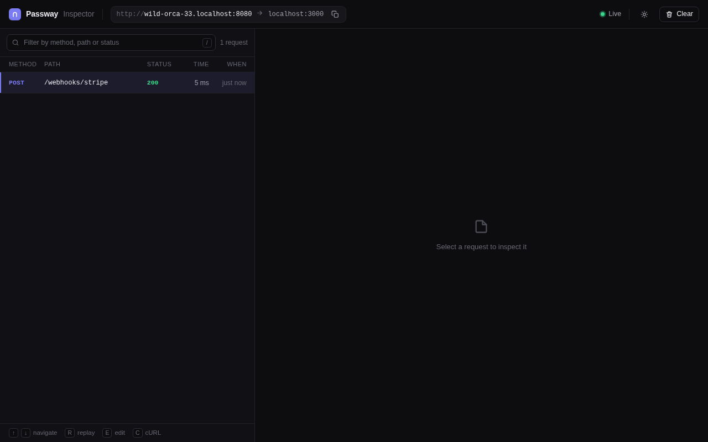

# Passway

**An open-source, self-hostable ngrok alternative built for webhook debugging.**
One command gives a local app a public URL.

> **Status: early development.** Milestone 1 (the core tunnel) and milestone 2
> (request inspector, replay and basic abuse protection) work: you can run your
> own relay server, expose a local HTTP app through it and inspect the traffic.
> Expect rough edges and breaking changes.

## What works today

- `passway http <port>` exposes a local HTTP app at `http://<name>.<your-domain>`
- Streaming request and response bodies
- Automatic reconnect, keeping the same public URL
- Token authentication (`--tokens`) and optional TLS on the relay server
- A friendly 502 page when the tunnel is offline
- A local request inspector with replay (see below)
- Per-tunnel rate limiting, a connection cap and an optional browser warning page

## Quickstart (local)

Requires the Go version listed in `go.mod`.

```sh
git clone https://github.com/Mohammed19N/devtunnel
cd devtunnel
```

In one terminal, start the relay server:

```sh
go run ./cmd/passway-server --domain localhost
```

To try the cloud flow locally (accounts, dashboard, plans) instead:

```sh
go run ./cmd/passway-server --mode cloud --domain localhost --db ./passway.db --dev-login
```

then open http://localhost:8080/auth/dev?login=you to sign in, create a token
under CLI tokens and run `passway login <token>`.

In another, start something to expose on port 3000, for example:

```sh
python3 -m http.server 3000
```

In a third, open the tunnel:

```sh
go run ./cmd/passway http 3000
```

The CLI prints a public URL such as `http://brave-marmot-93.localhost:8080`.
Request it:

```sh
curl http://<name>.localhost:8080/
```

`curl` resolves `*.localhost` to loopback by itself. Other clients may not, so
send the tunnel's hostname as a `Host` header instead:

```sh
curl -H 'Host: <name>.localhost:8080' http://127.0.0.1:8080/
```

## Inspect & replay webhooks

`passway http <port>` also starts a request inspector at
**http://127.0.0.1:4040** (if that port is taken it tries 4041 to 4049; the
CLI prints the address it chose). An explicit `--inspect-addr` is used as given, with no fallback. Every request that goes through the tunnel
shows up there live, with headers and bodies for both the request and the
response.



<!-- TODO(week 4): replace the screenshot with a short GIF of capture and replay. -->

- **Replay** sends a captured request to your local app again, unchanged
  (including headers such as `Stripe-Signature`). The replay appears as a new
  entry in the list.
- **Edit & Replay** lets you change the method, path, headers or body first.
  Edited bodies are sent as UTF-8 text; an unedited body is resent byte for
  byte.
- **Copy as cURL** builds a `curl` command for the captured request against
  your public tunnel URL.

The inspector keeps the last 500 requests in memory and stores at most 1 MB of
each body (larger bodies are marked truncated, but are always forwarded in
full). A request whose body the inspector did not see to the end, for example
because your app answered before reading it, is also marked truncated. A
truncated body has to be edited before it can be replayed, and WebSocket
connections cannot be replayed. The inspector listens on loopback only.

| Flag | Default | Meaning |
|---|---|---|
| `--inspect` | `true` | Run the inspector. Use `--inspect=false` to turn it off. |
| `--inspect-addr` | `127.0.0.1:4040` | Inspector listen address. Must be a loopback address. |

## Passway Cloud

Passway Cloud is the hosted version: sign in with GitHub, get a token, and
every account gets a stable default subdomain.

1. Sign in at the dashboard with GitHub.
2. Create a CLI token under **CLI tokens**. It is shown once.
3. `passway login <token>`
4. `passway http 3000 --server https://<cloud-domain>` prints your public URL.
   Reserved subdomains from the dashboard work with `--name <subdomain>`.

| | Free | Pro |
|---|---|---|
| Concurrent tunnels | 1 | 5 |
| Reserved subdomains | 1 | 5 |
| Bandwidth per month | 1 GiB | 50 GiB |
| Requests per minute per tunnel | 60 | 600 |
| Browser warning page | yes, names the owner | no |

These numbers are placeholders until the final plans are set (Pro billing
arrives in a later milestone; for now an operator sets plans with
`passway-server admin --db PATH set-plan <login> pro`). A suspended account's tunnels are closed and
its tunnel hosts show a 403 page.

### Running Passway Cloud

Like any relay it needs wildcard DNS and a wildcard TLS certificate for the
base domain; see [docs/self-hosting.md](docs/self-hosting.md).

`passway-server --mode cloud` (or `PASSWAY_MODE=cloud`) runs the cloud: accounts, a dashboard on the
base domain and plan limits, all backed by SQLite.

```sh
export PASSWAY_MODE=cloud
export PASSWAY_GITHUB_CLIENT_SECRET=...
passway-server --domain passway.example --db /var/lib/passway/p.db \
  --github-client-id <id> --tls-addr :443 --tls-cert cert.pem --tls-key key.pem
```

For local development, `--dev-login` adds a passwordless `/auth/dev?login=<name>`
sign-in. It only works on `localhost` domains:

```sh
passway-server --mode cloud --domain localhost --addr :8080 --db ./p.db --dev-login
```

Owner to-dos before a public launch:

- Create a GitHub OAuth app whose callback URL is
  `<base-url>/auth/github/callback`, and pass its client ID with
  `--github-client-id` and its secret in `PASSWAY_GITHUB_CLIENT_SECRET`.
- Put the base domain on the [Public Suffix List](https://publicsuffix.org/).
  Tunnels are subdomains of the dashboard's domain, so without this browsers
  share cookies between them.

| Flag (cloud) | Default | Meaning |
|---|---|---|
| `--db` | (required) | SQLite database path. |
| `--github-client-id`, `--github-client-secret` | (empty) | GitHub OAuth app. The secret may come from `$PASSWAY_GITHUB_CLIENT_SECRET`. |
| `--base-url` | `<scheme>://<domain>[:port]` | Public dashboard URL. Its host must be `--domain`. |
| `--min-github-age` | `48h` | Minimum GitHub account age to sign up (`0` disables). |
| `--free-signup-cap` | `1000` | Free accounts allowed; later signups are waitlisted. A waitlisted user is admitted at their next sign-in once there is room, or by an operator with `passway-server admin --db PATH admit <login>`. |
| `--free-bandwidth-cap` | `500 GiB` | Monthly bandwidth across all Free accounts, in bytes. |
| `--dev-login` | `false` | Passwordless dev sign-in (localhost only). |

## Running your own relay

Self-hosted is the default mode (`--mode self-hosted`): a relay with no accounts
or dashboard, random tunnel names and shared `--tokens`.

```sh
passway-server --domain tunnels.example.com \
  --tls-addr :443 --tls-cert cert.pem --tls-key key.pem \
  --addr :80 --tokens secret1,secret2
```

Clients authenticate with `passway login <token>` or `PASSWAY_TOKEN`, and pick
the server with `--server`. The full flag reference, DNS and TLS notes and the
admin commands are in [docs/self-hosting.md](docs/self-hosting.md).

## Roadmap

Accounts, plans and the dashboard work (milestone 3). Planned, not built yet:
paid plans with billing, custom domains and an install script.

## License

The CLI and the rest of the repository are licensed under the [MIT License](LICENSE).
The server (`cmd/passway-server`) is licensed under the
[AGPL-3.0](cmd/passway-server/LICENSE).
